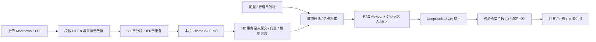
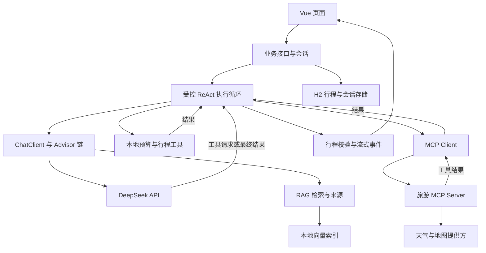

# 架构与接口

截至2026-10-24，第一至第四阶段均已实现。应用包含普通流式问答、持久化会话记忆、结构化行程、预算/时间检查、RAG 知识库，以及模型自主选择工具的受控 ReAct 循环。天气、地点和路线通过独立 MCP 服务访问真实公开接口；桌面安装包属于第五阶段。

## 运行组成

| 组件 | 计划方案 | 本机端口 |
| --- | --- | --- |
| 前端 | Vue 3、TypeScript、Vite | 5173 |
| 主后端 | Spring Boot、Spring AI、DeepSeek API | 8080 |
| 旅游 MCP 服务 | 独立 Java 应用、Streamable HTTP | 8081 |
| Embedding | Ollama、BGE-M3 | 11434 |
| 业务存储 | H2 文件模式，统一存入 `.data/` | 无额外服务 |
| 向量存储 | H2 中事务持久化向量，按城市计算余弦相似度 | 无额外服务 |

JDK 17 是当前本机基线。第 1 天锁定 Spring Boot 3.5.16、Spring AI 1.1.8，并完成构建验证。参考 [Spring AI 版本兼容说明](https://github.com/spring-projects/spring-ai/blob/main/README.md)，不同版本的 API 与依赖名称以锁定版本为准。

## 第三天已实现的 RAG 流程

上传元数据为权威来源字段，Markdown YAML 头保留在原文中但不参与向量化。问题与片段不会触发网页抓取或执行文档指令。检索上限4个片段、阈值0.50，适合最多60份的小知识库。

## 已实现的智能体请求流

## 模块边界

- Prompt：版本化提示词、需求变量、引用约束和结构化输出约定。
- Advisor：普通会话的记忆载入与本次 RAG 片段注入。智能体独立载入同一 JDBC 记忆，不使用自动工具执行。
- RAG：资料分块、向量化、按城市过滤、检索和来源关联。
- 本地 Tools：确定性预算计算和行程约束检查。
- MCP：独立服务暴露天气、地点和路线能力，主后端通过协议调用。
- ReAct：根据模型工具请求和工具返回结果推进任务，控制轮数、时间和结束状态。

主后端不直接依赖 MCP 服务的业务类。Controller 处理请求与响应，业务 Service 管理行程和资料，模型与工具编排放在 `ai/` 中。

## 核心数据

- `TravelRequest`：起止日期、出发地、目的地、人数、总预算、预算包含项、偏好。
- `Itinerary`：行程 ID、版本、每日活动、交通、费用估算、来源引用、待确认项。
- `Conversation` / `Message`：会话 ID、关联行程、消息角色、内容与时间。
- `KnowledgeDocument`：文档 ID、标题、城市、来源 URL、核实时间、索引状态。
- `AgentEvent`：执行 ID、事件类型、时间、工具调用 ID 和适合展示的摘要。

费用明确币种、总额/人均口径与是否为估算。知识片段保留文档 ID 与片段 ID。来源只引用实际命中的资料或实际查询的工具结果。前端显示行动摘要与工具记录。

## HTTP 接口

| 接口 | 用途 | 首次实现 |
| --- | --- | --- |
| `GET /api/health` | 服务健康与初始化状态 | 第 1 天 |
| `GET /api/integrations` | 模型、Embedding、MCP、旅游接口的配置/连通状态，不返回密钥 | 第 1 天起逐步补齐 |
| `POST /api/chat` | 接收会话 ID、可选行程 ID、消息，返回流式事件 | 第 1–2 天，后续扩展事件 |
| `POST /api/conversations` | 创建相互隔离的会话 | 第 2 天，已实现 |
| `GET /api/conversations/{id}` | 恢复草稿与完整聊天记录 | 第 2 天，已实现 |
| `POST /api/conversations/{id}/plan` | 按需求结构化生成，提交 expectedVersion 与 request | 第 2 天，已实现 |
| `POST /api/conversations/{id}/adjust` | 按 message 调整，提交 expectedVersion | 第 2 天，已实现 |
| `PUT /api/conversations/{id}/draft` | 提交编辑后的 itinerary 与 expectedVersion | 第 2 天，已实现 |
| `POST /api/conversations/{id}/save` | 校验 expectedVersion，保存当前草稿快照 | 第 2 天，已实现 |
| `GET /api/trips` | 已保存行程列表 | 第 2 天 |
| `GET /api/trips/{id}` | 查询行程 | 第 2 天 |
| `GET /api/trips/{id}/export` | 导出 Markdown | 第 2 天 |
| `POST /api/knowledge/documents` | 上传文本资料与来源元数据 | 第 3 天，已实现 |
| `GET /api/knowledge/documents` | 文档与索引状态列表 | 第 3 天，已实现 |
| `GET /api/knowledge/documents/{id}` | 原文与片段 | 第 3 天，已实现 |
| `GET /api/knowledge/status` | 模型/权重/维度、数量及重建提示 | 第 3 天，已实现 |
| `POST /api/knowledge/examples/import` | 导入六份官方示例摘要，相同城市与内容去重 | 第 3 天，已实现 |
| `POST /api/knowledge/documents/{id}/index` | 重试索引 | 第 3 天，已实现 |
| `POST /api/knowledge/rebuild` | 用当前模型事务重建全部文档 | 第 3 天，已实现 |
| `POST /api/knowledge/search` | JSON：city、query；返回真实片段 | 第 3 天，已实现 |
| `POST /api/knowledge/ask` | JSON：conversationId、city、message；返回已校验引用的回答 | 第 3 天，已实现 |

`POST /api/chat` 使用 `text/event-stream`，事件为 `conversation`、`status`、`delta`、`done`、`error`。普通生成/调整仍为同步 JSON。智能体独立使用下面的 POST 流式接口，前端以 fetch 读取 SSE。

| 第四阶段接口 | 用途 |
| --- | --- |
| `POST /api/agent/runs/stream` | executionId、conversationId、expectedVersion、可选 request 与 instruction；request 为空时调整现有有效行程 |
| `POST /api/agent/runs/{id}/cancel` | 终止执行，保留原有效行程 |
| `GET /api/agent/runs/{id}` | 完整持久化事件与终态 |
| `GET /api/conversations/{id}/agent-runs/latest` | 最近执行，无记录返回204 |
| `GET /api/tourism/tools` | MCP发现的三个真实旅游工具定义 |
| `POST /api/tourism/{name}` | 工具白名单内的只读查询，用于接口验收 |

智能体事件为 `started`、`action`、`retrieval`、`tool_start`、`tool_result`、`itinerary`、`done`、`error`。事件带单调序号、执行ID与时间。action 是应用行动摘要，不展示模型内部思维链。run 终态为 COMPLETED、CANCELLED、TIMED_OUT、LIMIT_REACHED 或 FAILED。未完成执行在服务重启后标记 FAILED / INTERRUPTED。

### 单一模型—工具循环

AgentConfiguration 使用锁定的 Spring AI 1.1.8，设置 `internalToolExecutionEnabled(false)`，只向模型提供工具定义。AgentService 显式保留 Assistant 工具调用消息与 ToolResponseMessage，按模型请求派发到 MCP Gateway 或本地工具，将真实结果反馈给下一轮。这样只有一套循环负责推进任务。

默认最多6轮模型决策、10次工具、90秒；独立计时器终止超时，不依赖模型及时返回。取消和提交使用同一会话锁，迟到结果不能覆盖原行程。会话写入受版本号与 ConversationGate 保护。最多两个执行同时运行。

最终 `calculate_budget` 接收完整行程，要求先尝试知识库、天气、地点查询，若已取得两个地点还要求路线查询。后端校验金额、日期、时间、步行、调整范围和引用，再绑定权威来源，校验合格直接提交，无需额外模型确认轮。第六轮的有效提交同样可以完成。工具失败记录为实际状态与待确认项；修复后的内部格式错误不作为未解决事项留给用户。

普通聊天通过 MessageChatMemoryAdvisor 使用最近十条消息；智能体手动载入同一记忆仓库中的正常消息，避免把未完成的工具对话写入普通记忆。智能体只在成功提交时追加请求与结果摘要。TravelKnowledgeAdvisor 注入本次 search_knowledge 实际命中的片段，资料与工具结果始终视为数据。

知识问答使用同步 JSON，请求完成后才显示已通过引用校验的答案；普通咨询仍使用 SSE。无命中时直接返回 INSUFFICIENT，不调用 DeepSeek；有命中但不足以回答时由模型明确拒答。ANSWERED 的 chunkId 必须来自本次命中，后端返回原始来源元数据并持久化到聊天历史。行程来源可沿用原有效草稿或本次检索，手动编辑不能改写来源。

上传错误返回400，文件超限413，导入并发或模型变化需重建409，向量服务/模型调用失败502。重建过程失败会保留之前有效的索引事务。

## 工具约定

| 工具 | 位置 | 输入和输出要点 |
| --- | --- | --- |
| `calculate_budget` | 主后端 | 汇总住宿/餐饮/交通/门票，返回总额与预算余额 |
| `check_schedule` | 主后端 | 确定性检查同日活动顺序/重叠与步行累计；普通与智能体行程均固定执行，不单独暴露给智能体选择 |
| `search_knowledge` | 主后端 | 目的地城市过滤的本机向量检索，返回真实文档/片段 ID |
| `weather_forecast` | MCP 服务 | 城市与日期；返回可用预报、覆盖范围、来源和查询时间 |
| `search_places` | MCP 服务 | 城市与关键词；返回地点、位置、来源 |
| `plan_route` | MCP 服务 | 起终点与交通方式；返回预计时长、距离及来源 |

当前采用无需密钥的 Open-Meteo、Photon、Valhalla 公开服务；日期超出预报范围、限流或网络失败都返回明确状态。假设场景与固定样例单独标识，不能显示为实时查询结果。

## 持久化与配置

启动脚本统一从项目根目录启动，运行数据位于 `.data/`。H2 保存会话、行程、资料原文、向量及 agent_runs / agent_events 执行记录。knowledge_documents、knowledge_chunks、knowledge_index_state 同处 `.data/db/travelbao.mv.db`，片段发布和模型信息以事务提交，避免独立文件快照与元数据不同步。模型名称或权重摘要改变会拒绝混用；查询或追加发现维度改变也要求重建。

第二天数据库表：conversations（权威需求与最新有效草稿、版本）、conversation_messages（完整 UI 聊天历史）、trips（最近明确保存的快照、关联会话 ID）、SPRING_AI_CHAT_MEMORY（Advisor 的十条近期记忆）。一个会话至多关联一个已保存行程；再次保存更新该快照。新会话生成新 UUID。读取已保存列表与导出使用保存快照；重新打开恢复该会话最新草稿，并标明未保存状态。

`.env.example` 只约定变量，密钥由后端和 MCP 服务读取。前端不保存模型/地图密钥。环境检查不读取 `.env` 内容；模型连通性由第 1 天的服务探针验证。

## 参考资料

- [Spring AI Advisor](https://docs.spring.io/spring-ai/reference/api/advisors.html)
- [锁定版本 1.1.8 的会话记忆说明](https://github.com/spring-projects/spring-ai/blob/v1.1.8/spring-ai-docs/src/main/antora/modules/ROOT/pages/api/chat-memory.adoc)
- [Spring AI RAG](https://docs.spring.io/spring-ai/reference/api/retrieval-augmented-generation.html)
- [锁定版本1.1.8工具调用](https://github.com/spring-projects/spring-ai/blob/v1.1.8/spring-ai-docs/src/main/antora/modules/ROOT/pages/api/tools.adoc)
- [真实旅游数据提供方及边界](tourism-providers.md)
- [MCP 架构](https://modelcontextprotocol.io/docs/learn/architecture)
- [DeepSeek 模型更新](https://api-docs.deepseek.com/updates/)
- [Ollama BGE-M3](https://ollama.com/library/bge-m3)

以上为概念和提供方参考；实际代码必须使用锁定版本对应的文档。
