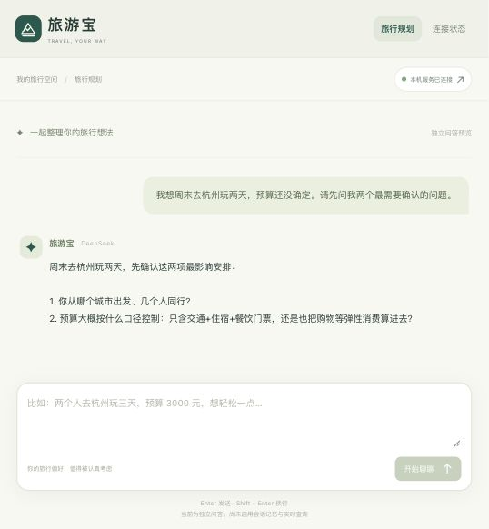

# 第 1 天实现与验收

日期：2026-10-22，Asia/Shanghai。真实接口最终验收时间：20:31:50。

## 已实现

- Java 17、Spring Boot 3.5.16、Spring AI 1.1.8 的两个可执行应用。
- Vue 3.5.44、TypeScript 5.9.3、Vite 8.3.5 前端与 npm 锁文件。
- 旅行规划问答界面：示例输入、真实流式回复、加载状态、停止生成、错误提示。
- 服务连接界面：模型文本、真实预算工具调用、MCP、Embedding 四类验证。
- Apache Maven Wrapper、项目内缓存、配置加载、构建、启动、停止、验收脚本。
- 独立 MCP Streamable HTTP 服务和 `travel_service_info` 工具。

## 版本与配置决定

模型端点仍为 DeepSeek，采用 Spring AI 的兼容协议适配器传递 `thinking.type=disabled`，无需其他模型提供方账户。固定依赖版本，不使用快照构件。MCP 客户端延迟连接，外部服务未启动时不阻止主页面显示。

本机 `.env` 通过 Node 标准解析器加载，不执行其中代码。密钥不进入前端构建环境。重建后的 JAR 在下次启动生效；运行中的服务使用独立副本，避免构建覆盖导致类加载异常。

## 验收状态

本机 `.data/verification/day1.json` 的最终结果为八项全部通过。该报告由真实运行的接口产生，自动化测试中的模拟模型不计入真实 API 验收。

| 验证 | 结果 | 证据 |
| --- | --- | --- |
| 前端页面 | 通过 | HTTP 返回正常，页面可加载 |
| 后端健康 | 通过 | 返回 `travelbao-backend` 和 `UP` |
| MCP | 通过 | 协商协议 `2025-11-25`；初始化、工具发现、`travel_service_info` 实际调用成功 |
| Embedding | 通过 | BGE-M3 返回 1024 维非零有效向量 |
| DeepSeek 文本 | 通过 | 真实模型返回连接验证答复 |
| 模型工具调用 | 通过 | 模型实际请求预算工具；1500 + 800 + 500 得到 2800 元，并回传模型 |
| 流式回复 | 通过 | 收到 34 个真实内容片段及最终 `done` 事件 |
| 输入校验 | 通过 | 空消息返回 HTTP 400，不调用模型 |

`node scripts/build.mjs` 通过：五项 Java 自动化测试零失败、两个 Java 应用打包成功、前端类型检查和生产构建成功。Maven Wrapper 的独立 `validate` 命令也已通过。

浏览器验证包括真实旅行问题发送与回复展示、停止生成后恢复输入，以及桌面和窄屏的横向溢出检查。前端构建产物中未发现服务端模型密钥。



[查看四项服务连接验证截图](screenshots/day1-connections.jpg)。

自动化测试覆盖工具请求序列化与结果回传、未配置密钥的终止错误、模型仅口头计算不能算工具执行、认证错误正文脱敏。前端构建包含 TypeScript 检查。

模型从 Ollama 官方仓库下载，SHA-256 为 `daec91ffb5dd0c27411bd71f29932917c49cf529a641d0168496c3a501e3062c`。由于本机代理与 Ollama 下载器地址校验不兼容，已通过校验文件摘要后的本地导入完成安装，未关闭下载器安全校验。

## 当前边界

当前支持独立问答。会话记忆、行程保存、知识库检索、实时旅游工具和受控 ReAct 循环按第 2–4 天计划实现。MCP 目前返回真实服务状态，不提供虚构天气或路线。

## 操作

```bash
node scripts/build.mjs
node scripts/dev.mjs
# 在另一终端运行真实验收
node scripts/verify-day1.mjs
# 停止服务
node scripts/stop.mjs
```

页面地址：http://127.0.0.1:5173。
