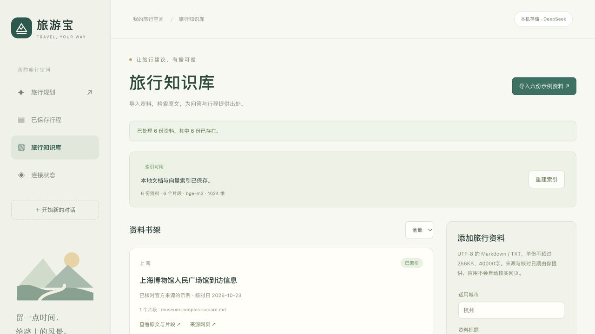
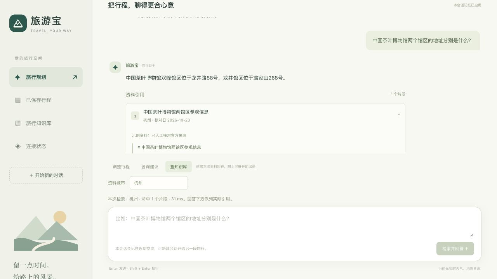

# 第三天：RAG 知识库完成记录

实际开发与验收：2026-10-23，Asia/Shanghai；原排期为10月24日，按用户要求提前完成。应用阶段为 day-3 / v0.3.0。

## 现在能做什么

“旅行知识库”支持六份示例一键导入、按城市筛选、上传 UTF-8 Markdown/TXT、查看原文与索引片段、检索、失败后重试和整体重建。在聊天中选“查知识库”，根据本次片段回答，展示可展开的原文摘录、核对日、文档/片段 ID 与来源链接。普通“咨询建议”保持流式问答。

行程生成与调整会按目的地自动检索。DeepSeek 返回的来源 ID 必须来自本次检索或原有效行程，后端绑定原始元数据；用户手动编辑不能伪造来源。保存与 Markdown 导出包含出处。旧版行程继续可读，其 Prompt 版本保持 v2。

检索命中不代表资料一定用于该行程。未使用其中事实时允许来源为空，避免为了凑引用而改变用户偏好；实际使用资料的安排仍应注明出处。

## 示例资料

六份官方网页摘要于2026-10-23核对，每城两份；没有复制整篇网页。来源 URL、适用范围与发布日期差异见 [来源核对记录](rag-source-audit.md)。

| 城市 | 资料 | 文档 ID |
| --- | --- | --- |
| 杭州 | 中国茶叶博物馆两馆区参观信息 | hangzhou-tea-museum |
| 杭州 | 中国丝绸博物馆个人与团体参观安排 | hangzhou-silk-museum |
| 苏州 | 拙政园地址与园内分区 | suzhou-humble-administrator-garden |
| 苏州 | 留园地址与景区特点 | suzhou-lingering-garden |
| 上海 | 上海博物馆东馆到访信息 | shanghai-museum-east |
| 上海 | 上海博物馆人民广场馆到访信息 | shanghai-museum-peoples-square |

本机已导入，当前六个片段。摘要均短于600字，因此各一个片段；长文按600个字符、100字符重叠分块，保留段落并保护 Unicode 边界。YAML 元数据头仅保留在原文中，上传表单或示例目录的元数据作为系统来源字段。

## 实际实现与技术位置

1. `KnowledgeService` 校验格式、UTF-8、大小和元数据，同一城市与标准化内容 SHA-256 去重。单份最大256KB、20–40000字符，最多60份。
2. `OllamaKnowledgeEmbedder` 读取本机模型标识与权重摘要，调用 `/api/embed`，检查有效维度并归一化向量。当前 BGE-M3 为1024维。
3. `KnowledgeRepository` 把原文、片段、向量和模型元数据放入 H2 文件数据库。发布/重建以事务提交，失败不会写入半套新索引；重启恢复无需重新嵌入。
4. 查询先按城市筛选，再计算余弦相似度，默认阈值0.50、最多4个片段。当前规模直接扫描本机向量，后续资料量明显增加时再换专门向量库。
5. `TravelKnowledgeAdvisor` 是 Spring AI BaseAdvisor，排序在记忆 Advisor 之后，注入本次片段 JSON。片段被标为资料数据，文档内指令不作为系统指令；旧检索上下文不写入会话记忆。
6. `KnowledgeAnswerService` 约束为 ANSWERED/INSUFFICIENT，校验真实 chunkId，返回后端原始出处。有命中但无法支持问题时仍需拒答；无命中直接提示不足，不调用 DeepSeek。
7. Prompt v3 增加资料引用与适用日期约束；预算/时间仍由原有确定性工具检查。保留 v1/v2 和原来的对照实验。

原计划的独立向量文件快照调整为同一 H2 数据库事务持久化，减少资料元数据与向量不同步的问题。数据库仍位于 `.data/db/travelbao.mv.db`，不新增常驻服务。

## 验证结果

| 验证 | 实际结果 |
| --- | --- |
| Maven 构建与离线测试 | 28项通过，0失败；其中10项知识库测试，另补重复“第二天”提及的回归测试 |
| 前端 | TypeScript 检查与 Vite 生产构建通过 |
| 官方示例导入 | 6份、6片段、BGE-M3 1024维 |
| 去重与上传 | 示例重复导入、同内容 multipart 上传均不增加数量或覆盖出处 |
| 上传错误 | 无效 UTF-8 / PDF 返回400；超256KB返回413 |
| 城市与重建 | 跨城市资料不混入结果；整体重建后数量相同、索引代次更新 |
| 固定有据问答 | 10/10通过关键词、正确文档引用及引用来自真实检索的检查 |
| 无据问题 | 2/2返回资料不足，空引用；天气问题虽有弱相关片段，仍正确拒答 |
| 真实行程 | 上海两天双馆行程引用两份真实资料，保存/导出带片段 ID 和核对日，篡改来源被拒绝 |
| 重启 | 文档数、片段数、模型权重/维度、索引代次与检索片段一致；聊天和行程来源恢复 |
| 页面 | 一键导入去重、城市筛选、原文定位、检索、带引用回答、已保存行程来源均操作通过；375px页面无横向溢出 |
| 原链路回归 | 第一天8/8通过；第二天六组业务验收与两组重启验收通过，包括30分钟单日步行上限和数据库记忆恢复 |

固定问题及人工参考答案位于 `knowledge-data/qa-cases.json`。本次真实报告在 `.data/verification/day3.json`，先完成业务检查，再重启验收后标记 `allPassed=true`。10/10仅代表这组静态资料和固定问题，不代表任意旅游问题的正确率。

回归时发现“第二天少走路，请把第二天……”重复提及同一天被旧逻辑误判为多天，导致跳过步行上限检查。已按不同日期去重，补充针对性测试，再运行真实调整验收通过。

## 自己体验

在项目根目录启动：

```bash
node scripts/dev.mjs
```

打开 http://127.0.0.1:5173 ，进入“旅行知识库”。资料已导入，重复点击会显示六份已存在。问“中国茶叶博物馆两个馆区的地址分别是什么？”，再展开回答引用。可对照 [逐项验证清单](verification-guide.md) 执行上传、无据回答和重启检查。

```bash
node scripts/verify-day3.mjs
# 停止并重新启动服务后
node scripts/verify-day3.mjs --after-restart
```

脚本会调用真实 DeepSeek 并创建独立验收会话/上海行程，报告覆盖为本次结果；不会修改其他已有行程。

## 当前边界与下一步

资料是核对日的静态摘要。用户上传的来源与日期由上传者提供，程序不会自动访问来源网页核对。检索相似度不是可信度，合法片段 ID 也不能自动证明回答的每句话均被支持，仍需结合摘录判断。行程的费用、交通与步行为估计，实时开放或特展票价需复查。

知识问答完成引用校验后一次显示；普通咨询仍逐字流式显示。第三天没有引入天气/地图查询或 ReAct 自主工具循环。下一阶段实现真实旅游 MCP 工具与受控 ReAct 编排；桌面包留在第五阶段。




